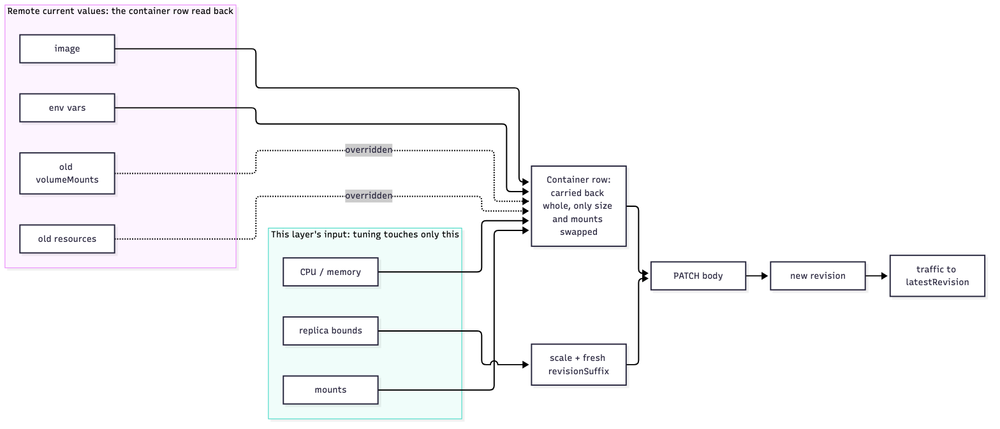

# Quarterly capacity tuning — don't write last month's image back

## Background

At October's cost review, relay's dev **Azure Container Apps** (managed container apps) got called out on its own: 2 CPUs, 4 GiB, up to 10 replicas. Peak CPU over the last thirty days: 12%; the replica count never passed 2.

Dee dropped the bill and a Usage screenshot into the group chat: "It was sized to the peak, and nobody ever looked back."

---

Nobody had ever really owned capacity. It used to live in each pipeline's release parameters — whoever released, tweaked it on the way through. After the platform took over, the stale parameters in pulse's pipeline were never fully removed, and both sides started editing their own copies: once, a 2 a.m. release dragged the replica count straight back to peak after the afternoon's downgrade.

---

So the platform group decided to make this a fixed motion: every quarter, walk every team's capacity — scale down what should shrink, scale up what should grow.

Dee restated the rule in the chat: capacity gets reviewed once a quarter, and only CPU, memory, and the replica range move; anything with file shares attached gets its mounts reviewed together. Images, environment variables, and secret references stay with each team's pipeline releases.

A relay developer replied below: so for this round, should we book a release window?

"Three teams, dev and prod each, one round per quarter — the calendar can't fit that many windows." Dee paused. "Capacity and mounts are deployment-shape concerns; they have nothing to do with which version ships. The numbers are ours to adjust."

---

Easier said than done. Nobody touched this stack day to day; the last apply was a month ago.

On the first attempt, Dee changed relay's `max_replicas` from 10 to 3, and the `plan` showed — besides the replica count — one extra line: an image change.

---

The first suspicion was editing the wrong place. Back in that tfvars file, under the capacity block, there really was an `image_tag` line — a value written the last time the platform touched this stack a month ago. Since then the pipeline had shipped a dozen releases, and nobody had touched this line — image changes don't travel this road.

Opening the plan details: the old value was the version actually running in production, and the new value was exactly that month-old tag sitting in tfvars. No one had touched the image, yet the moment this plan was applied, what ran on Azure would be the version from a month ago.

---

The plan was closed, the apply left unclicked. The rule in the chat still stood: numbers belong to the platform. But right now, changing one number meant carrying a month-old tag along with it.

## Comparison: first try — mask the image field

The laziest idea: make the plan compare only the capacity fields and hang `ignore_changes` on everything else:

```hcl
resource "azurerm_container_app" "app" {
  name = "aca-relay-dev"

  template {
    container {
      name   = "app"
      image  = var.image_tag
      cpu    = var.template_cpu
      memory = var.template_memory
    }

    min_replicas = var.min_replicas
    max_replicas = var.max_replicas
  }

  lifecycle {
    ignore_changes = [template[0].container[0].image]
  }
}
```

`ignore_changes` governs the plan, not what gets sent. The masked field is no longer compared, and the plan quietly takes whatever value Terraform holds in state.

With this version, the plan was indeed clean. But `template` still has other fields. When the pipeline added an `args` in one release, or an extra probe, this plan schedules an update; and an update sends the whole `template` block — since the image field isn't compared, it's refilled from whatever Terraform happens to hold. Which version that is depends on when Terraform last read it, not on what the pipeline just shipped.

Edit one environment variable, and the image rolls back once. Add fields to the ignore list one by one? Miss one and it's a rollback. Mask the entire `template` then: the plan is clean, and capacity stops being compared too — the numbers change with no diff, and nothing gets sent at all.

Both ends blocked, the problem had moved: `azurerm_container_app` sends a whole-resource update, and there is no "send only these fields" mode. However finely the variables split, what lands on Azure is still the entire `template`.

## Comparison: writes move to PATCH, and capacity becomes replace-only

Azure always had an interface that changes only part of a resource. `PATCH` merges — fields you don't supply keep their remote values. `azurerm_container_app` offers no such mode, so to send a PATCH the write has to move to `azapi_resource_action`.

The switch makes the plan harder, not easier. The request body is one whole block, carrying a `revisionSuffix` that differs every round, plus fields echoed back from the remote. Without `ignore_changes`, every plan shows a diff; with it, capacity gets masked along with everything else.

So capacity can't ride an update — it can only ride a replace. Replace means destroy then create; this `azapi_resource_action` carries `when = "apply"`, so no stray PATCH goes out on destroy. Create has no prior state — fields masked by ignore can't be read back from state, and the body can only be assembled from config; config has no image, so the only usable source is what was read from the remote just before the PATCH.

That's how the two concerns split: the whole body is masked, so day-to-day drift never enters the plan; when capacity changes, this action is rebuilt once, and the rebuild recomputes the body from the remote's current values. Neither side accommodates the other.

```hcl
resource "azapi_resource_action" "template" {
  type        = "Microsoft.App/containerApps@2025-07-01"
  resource_id = azurerm_container_app.this.id
  method      = "PATCH"
  when        = "apply"

  body = { properties = { template = local.template_patch_body } }

  lifecycle {
    ignore_changes       = [body]
    replace_triggered_by = [terraform_data.sizing]
  }
}
```

What gets rebuilt is this action, not the ACA itself. Carrying `when = "apply"`, it sends no request on destroy — a rebuild is just another PATCH following config.

## Approach

The whole PATCH recomputes only two spots in the container row — capacity and scale — and carries everything else back as-is.

On the left, the container row read back from the remote; on the right, the capacity being changed this round; the two merge into one body:



**1. Collect only capacity and mounts**

The four capacity numbers come in from the tuning tfvars. Mounts ride the same line: changing a file share shouldn't disturb a release. image, env, and secret references don't even get variables declared — this layer holds none of them, so it can't carry any out.

**2. Read the remote first**

Before the PATCH, read the whole container row back; image and env always take the values just read:

```hcl
data "azapi_resource" "live" {
  type        = "Microsoft.App/containerApps@2025-07-01"
  resource_id = azurerm_container_app.this.id

  response_export_values = [
    "properties.template",
    "properties.configuration.registries",
  ]
}

locals {
  live_template  = data.azapi_resource.live.output.properties.template
  live_container = coalesce(
    [for c in local.live_template.containers : c if c.name == var.name][0],
    local.live_template.containers[0],
  )
}
```

**3. Compute the fingerprint**

The fingerprint can't cover only the four numbers — it tracks "what this layer owns." Since this layer also owns mounts, the md5 of `volume_mounts` is appended:

```hcl
locals {
  volumes_fingerprint_suffix = length(var.volume_mounts) > 0 ? ":${md5(jsonencode(var.volume_mounts))}" : ""

  sizing_trigger_fingerprint = md5(format("%v:%v:%v:%v%s",
    var.template_cpu,
    var.template_memory,
    var.min_replicas,
    var.max_replicas,
    local.volumes_fingerprint_suffix,
  ))
}

resource "terraform_data" "sizing" {
  input = local.sizing_trigger_fingerprint
}
```

`replace_triggered_by` recognizes only this `terraform_data`'s `input`.

So the fingerprint draws exactly this layer's boundary: whatever sits inside it, this layer governs.

If the image were included, every pipeline release would change the fingerprint, and the capacity side would rebuild with it — releases and tuning would be chained together again.

Don't put image or env in the fingerprint. When this layer takes over one more concern later, add the matching item to the fingerprint then. Until then, releases are releases, and tuning is tuning.

**4. Assemble the body and write back**

Two spots are easy to miss on write-back; miss either and this PATCH is wasted. `revisionSuffix` must be fresh on every rebuild — truncating just the fingerprint collides with the previous round's name and the server mints no new revision; and once the template changes a new revision exists, but the pipeline may have pinned traffic to the old one, so the body must shift traffic to `latestRevision`.

```hcl
locals {
  revision_suffix = substr(md5(format("%s:%s", local.sizing_trigger_fingerprint, plantimestamp())), 0, 12)

  template_patch_body = {
    revisionSuffix = local.revision_suffix
    scale = {
      minReplicas = var.min_replicas
      maxReplicas = var.max_replicas
    }
    containers = [merge(local.live_container, {
      resources = merge(local.live_container.resources, {
        cpu    = var.template_cpu
        memory = var.template_memory
      })
    })]
  }
}

resource "azapi_resource_action" "template" {
  type        = "Microsoft.App/containerApps@2025-07-01"
  resource_id = azurerm_container_app.this.id
  method      = "PATCH"
  when        = "apply"

  body = {
    properties = {
      template = local.template_patch_body
      configuration = {
        ingress = {
          traffic = [{ latestRevision = true, weight = 100 }]
        }
      }
    }
  }

  lifecycle {
    ignore_changes       = [body]
    replace_triggered_by = [terraform_data.sizing]

    precondition {
      condition     = try(local.live_container.image, null) != null
      error_message = "${var.name}: the remote template has no container image — release first, then tune capacity."
    }
  }
}
```

PATCH is a merge patch: fields not supplied keep their remote values — with one exception for arrays. The moment you supply `containers`, the whole array is yours to mean. So to change `resources`, the container row must be carried back whole; miss an `image` or `env` and it gets replaced along with everything else.

`merge` is a shallow merge. Writing `resources = { cpu = …, memory = … }` would replace the entire `resources` — if the remote still carries `ephemeralStorage`, it's gone. So `resources` and the container row each get their own merge layer, replacing only the keys this layer claims.

Mounts follow the same rule: when `volume_mounts` is non-empty, carry `volumes` and `volumeMounts` together; when empty, omit the block entirely rather than sending an empty array.

**5. Each field has its owner**

| Who | Changes what | How often |
| --- | ------------ | --------- |
| Platform ops | cpu, memory, replica range | reviewed each quarter |
| Team developers | image tag, env, secret references | every release |

## Example & verification

| Directory | What it's for |
| --------- | ------------- |
| [`maintenance/aca-size-update/`](https://github.com/NewbMiao/terraform-on-azure-examples/tree/main/maintenance/aca-size-update/) | Runs without touching Azure: `var.live` plays the remote reading, `terraform_data` plays the template PATCH, and the variable names match the platform-side ACA module's inputs |

Run `terraform init` and then `terraform plan`; `applied_template` is the body actually written last time — check it against these three scenarios:

1. Change only `live.image`, as if a release just shipped → `terraform_data.template` shows no change.
2. Change only `max_replicas` → the template rebuilds with a fresh `revisionSuffix`, while the body still carries the post-release image value.
3. Change only `volume_mounts` → the fingerprint moves, the rebuild happens the same way, and `volumes` / `volumeMounts` update along.

## Quiz

Could the same `ignore_changes` **+** `replace_triggered_by` combination (with a `data` read of current values before the PATCH) be applied directly to `azurerm_container_app`, so apply never writes the stale image held in state back out? Why or why not?

## Takeaway

The plan Dee closed wasn't wrong because the replica count was miscalculated — it was wrong because **the platform's quarterly tuning and the team's releases both touched the same template, and nobody had drawn which segment each one edits**.

Terraform doesn't have to be welded to "one resource, one update writes the whole table." Split the write path by **who moves what, and how often**, and the rule lands in configuration: the platform tunes capacity each quarter, teams ship each release, and each governs its own — **flexible use of patterns exists so operations and development can stay autonomous, not to book more release windows or fight over one apply path**.
