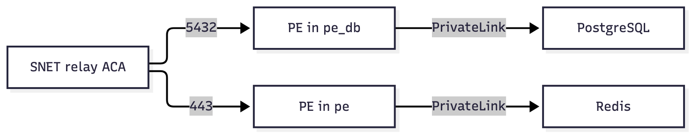
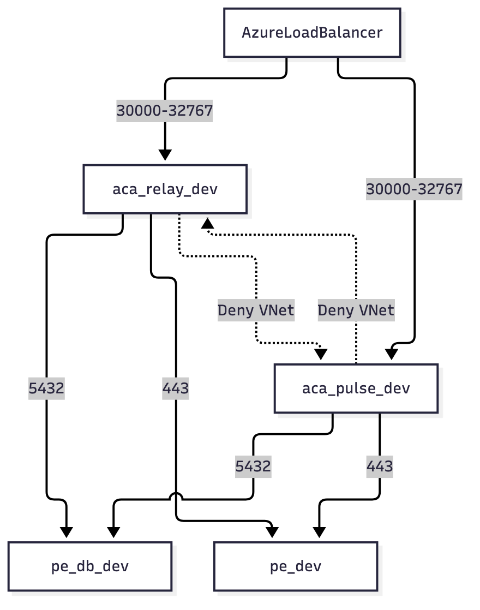
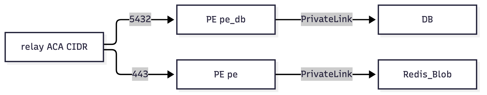

# A public scan reached the database — the subnet boundaries were never drawn

## Background

relay dev's **PostgreSQL Flexible Server** (managed PostgreSQL) had **Public network access** on the whole time. Last night the monitoring graph showed overseas addresses sweeping **5432**, and the connection string still pointed at a public hostname.

---

pulse's **Azure Container Apps** (serverless container platform) had no **Virtual Network** (VNet) injection, so traffic still rode the default public **FQDN**. harbor's prod sat in **EA**; when Dee poked around over there, the apps and the databases were just as exposed to the public network.

---

Dee from the platform group walked a checklist against the inventory: overseas sweeps on **5432** were one front; between teams there was only a **Resource Group** dividing line, and the subnets inside the **VNet** were never fully drawn — who sits next to whom, and where databases and **PE**s (Private Endpoints) should land, still had rows missing from the sheet.

---

bob asked in the group chat: "apps first or databases first?" Dee's answer: "Connect the environment to the **VNet** first — the subnet edges have to be drawn before anything else." How **Front Door** and the **WAF** (Web Application Firewall) attach is a separate sheet; this round is only about internal segmentation.

## Comparison: everything on the public network

```hcl
resource "azurerm_postgresql_flexible_server" "relay_dev" {
  name                          = "relay-pg-dev-sea"
  resource_group_name           = "RG-RELAY-DEV-SEA"
  location                      = "southeastasia"
  public_network_access_enabled = true
}

resource "azurerm_container_app_environment" "relay_dev" {
  name                     = "relay-aca-env-dev-sea"
  resource_group_name      = "RG-RELAY-DEV-SEA"
  infrastructure_subnet_id = null
}
```

Between one team's **ACA** and another's there was nothing but a different **Resource Group** — no subnet boundary; **Storage** and **Redis** also rode public **Endpoint**s.

## Comparison: moving inside — users still enter through Front Door + WAF, subnets face inward

"Just close public access and slap on a **PE** — done, right?" Dee added: closing the exposed surface is one thing, but **neighbors** still need subnet edges — users keep entering through **Front Door** + **WAF**; what follows only draws how to segment the data plane once everything lands in the same **VNet**.

Once **ACA** is attached to the **VNet**, the same network segment can still reach everything on it by default — a **Resource Group** doesn't stop that. The runtime environment needs the **Microsoft.App/environments** delegation, and the rule is **one environment, one subnet**, so each team gets its own `aca_*` slice.

**PE**s land on **NIC**s inside subnets: databases ride **5432**, general services ride **443**; if they crowd into the same segment they're hard to tell apart — database **PE**s go into `pe_db_*`, while Redis, Blob, and KV share `pe_*`. The data-plane path: **ACA → PE → backend**.

| Facing out | Facing in (subnets by role) |
| ---------- | --------------------------- |
| **Front Door** + **WAF** → internal **ACA** | Data plane off the public network, via **Private Endpoint** |
| No default domain names scattered around | `aca_*` one per team · `pe_db_*` databases · `pe_*` general **PE**s |



```hcl
virtual_networks = {
  dev_sea_01 = {
    name             = "VNET-EG-DEV-SEA-01"
    location         = "southeastasia"
    address_space    = ["172.20.0.0/22"]
    subscription_key = "dev"
    subnets = {
      aca_relay_dev = {
        name             = "SNET-EG-DEV-ACA-RELAY"
        address_prefixes = ["172.20.0.0/26"]
        delegation = {
          name         = "Microsoft.App/environments"
          service_name = "Microsoft.App/environments"
          actions      = ["Microsoft.Network/virtualNetworks/subnets/join/action"]
        }
      }
      aca_pulse_dev = {
        name             = "SNET-EG-DEV-ACA-PULSE"
        address_prefixes = ["172.20.0.64/27"]
        delegation = {
          name         = "Microsoft.App/environments"
          service_name = "Microsoft.App/environments"
          actions      = ["Microsoft.Network/virtualNetworks/subnets/join/action"]
        }
      }
      pe_db_dev = {
        name             = "SNET-EG-DEV-PE-DB"
        address_prefixes = ["172.20.0.128/27"]
      }
      pe_dev = {
        name             = "SNET-EG-DEV-PE"
        address_prefixes = ["172.20.0.160/27"]
      }
    }
  }
}
```

```hcl
resource "azurerm_private_endpoint" "relay_pg" {
  name      = "pe-relay-pg-dev"
  subnet_id = data.azurerm_subnet.pe_db_dev.id
  # private_service_connection -> postgresqlServer
}

resource "azurerm_private_endpoint" "relay_redis" {
  name      = "pe-relay-redis-dev"
  subnet_id = data.azurerm_subnet.pe_dev.id
}
```

## Approach

**dev / prod** × **region** (SEA, EA) each get one **VNet**, with `subscription_key` as `dev` / `prod` and non-overlapping address spaces:

| VNet key | Region | Environment | Address space |
| -------- | ------ | ----------- | ------------- |
| `dev_sea_01` | southeastasia | dev | `172.20.0.0/22` |
| `prod_sea_01` | southeastasia | prod | `172.21.0.0/22` |
| `prod_ea_01` | australiaeast | prod | `172.22.0.0/22` |

1. In `virtual_networks`, add an `aca_*` subnet with delegation for each team; register **PE**s under `pe_db_*` and `pe_*`, and wire each team **ACA** environment into its `aca_*`.
2. Turn off the data plane's public access; database **PE**s only ever enter `pe_db_*`, while Redis, Blob, KV and the like share `pe_*`.
3. Attach an **NSG** (network security group) to every subnet and write the allowed inbound/outbound as rules; traffic not in the rules is not expected to pass. Team **ACA**s get a **Deny VirtualNetwork** on top; go finer later by splitting out dedicated PE subnets.
4. **EA** and **SEA** reuse the same key-name pattern — only `address_space` and `location` change.

## NSG baseline rules (dev SEA as the example)

Once subnets have their roles, the **NSG** binds to the subnet and Allow rules are written by source, destination, and port; anything not written into a rule is not expected to pass.

dev SEA has three common shapes: **ACA** outbound only opens toward the `pe_db` and `pe` prefixes; `pe_db` inbound only recognizes each team's **ACA** CIDR; and lateral team-to-team **ACA** traffic gets a **Deny VirtualNetwork** (the Allow rules need smaller priority numbers — allow first, then block wide).

Inbound on the **ACA** subnet must leave **30000–32767** open to **Azure Load Balancer** (health probes and portal-based inbound). The two diagrams below draw only the paths allowed inside the network: the first for the whole team set, the second narrowed to relay's single **ACA → PE → backend** line.





## Example & verification

| Directory | What it's for |
| --------- | ------------- |
| [`security/shared-vnet-subnet-nsg-edges/`](https://github.com/NewbMiao/terraform-on-azure-examples/tree/main/security/shared-vnet-subnet-nsg-edges/) | Three environments' `virtual_networks` + sample **NSG** rules; the reading order is in that directory's `README.md` |

## Quiz

`pe_db_*` hosts only database **Private Endpoint**s, and `pe_*` hosts Redis, Blob, KV and the rest — beyond the different ports, what else do you gain by putting databases and general services in two separate subnet segments?

## Takeaway

The overseas sweep on **5432** settled the bill: closing public access alone isn't enough — inside the same **VNet**, subnets still have to be drawn by role. Users keep entering **ACA** through **Front Door** + **WAF**, and the data plane runs **ACA → PE → database**; each team gets one **ACA** subnet, the **NSG** only passes traffic written into rules, and a **Resource Group** never stopped neighbor traffic in the first place.
