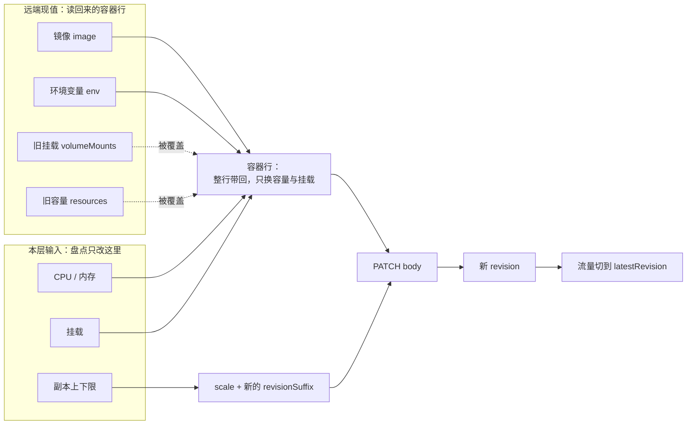

# 每季度调一次容量，别把上个月的镜像一起写回去

## 背景

十月的成本复盘会上，relay 的 dev **Azure Container Apps**（托管容器应用）被单独拎了出来：2 CPU、4 GiB、最多 10 个副本。最近三十天的 CPU 峰值 12%，副本数没超过 2。

小 D 把账单和 Usage 截图发到群里：「照着峰值配的，配完就没人回头看过。」

---

容量这块一直没人专门认领。原先都写在各自 pipeline 的发版参数里，谁发版谁顺手调一下。平台接过来之后，pulse 那条 pipeline 里的旧参数没删干净，两边就各改各的：有次凌晨发版，把下午刚降下去的副本数又拉回峰值。

---

于是平台组打算把这件事变成固定动作：每季度把各队的容量过一遍，该降的降，该升的升。

小 D 在群里把规矩说了一遍：容量每季度盘一次，只动 CPU、内存、副本范围；挂了文件共享的，挂载一起盘。镜像、环境变量、secret 引用还是各队 pipeline 发版。

relay 的开发在下面接了一句：那这次盘点，要不要排个发布窗口？

「三个队，dev、prod 各一套，一季一轮，排不过来。」他停了停，「容量和挂载都是部署形态的事，跟发哪个版本没关系。数字我们自己调。」

---

话说得轻巧。这套栈平时没人碰，上一次 apply 还是一个月前。

第一次动手，小 D 把 relay 的 `max_replicas` 从 10 改成 3，`plan` 里除了副本数，还多出一行镜像变更。

---

他先怀疑自己改错了地方。翻回那份 tfvars，容量下面确实有一行 `image_tag`，是上个月平台最后一次动这套栈时写下的值。之后流水线发了十几版，这行一直没人动——改镜像不走这条路。

再点开 plan 的详情：旧值是线上正在跑的那版，新值就是 tfvars 里这个放了一个月的 tag。他手上没动镜像，可这份 plan 一旦 apply，Azure 上跑的就是一个月前那一版。

---

plan 关掉了，apply 没敢点。群里那条规矩还挂着：数字归平台。可眼下改一个数字，就得把一个月前那个 tag 一起扛上。

## 对比：先试遮住镜像那一项

最省事的想法，是让 plan 只比容量那几项，别的挂上 `ignore_changes`：

```hcl
resource "azurerm_container_app" "app" {
  name = "aca-relay-dev"

  template {
    container {
      name   = "app"
      image  = var.image_tag
      cpu    = var.template_cpu
      memory = var.template_memory
    }

    min_replicas = var.min_replicas
    max_replicas = var.max_replicas
  }

  lifecycle {
    ignore_changes = [template[0].container[0].image]
  }
}
```

`ignore_changes` 管的是 plan，不是发出去的内容。被挡住的字段不再比较，plan 里直接取 Terraform 手上记的那份值。

改完这一版，plan 确实干净了。可 `template` 里还有别的字段。流水线在某个版本里加了一个 `args`、多了一个 probe，这次就计划一次 update；update 发出去的是整块 `template`，镜像那一项既然不比，就按 Terraform 手上那份填回去。填的是哪一版，取决于它什么时候读到的，不取决于流水线刚发的是哪一版。

改一行环境变量，镜像跟着退一次。一个字段一个字段补进 ignore 呢？漏一个就是一次回滚。索性把整块 `template` 遮掉：plan 是干净了，容量也不比了——数字改了没有 diff，什么都不会发出去。

两头都堵着，问题已经换了地方：`azurerm_container_app` 发的是整份资源的 update，没有「只发这几项」的写法。变量拆得再细，落到 Azure 仍是整块 `template`。

## 对比：写回改走 PATCH，容量就只剩重建

Azure 那边本来就有只改一部分的接口。`PATCH` 走 merge，没给的字段保留远端原值。`azurerm_container_app` 不提供这种写法，要发 PATCH，写回就得交给 `azapi_resource_action`。

换过来之后，plan 反倒更难收拾。请求体是一整块 body，里面有每轮都不一样的 `revisionSuffix`，也有从远端回显的字段。不挂 ignore，plan 每轮都有差；挂上去，容量也跟着一起被遮住。

所以容量走不了 update，只能走 replace。replace 走 destroy 再 create；这条 `azapi_resource_action` 带了 `when = "apply"`，destroy 时不会误发 PATCH。create 没有 prior state——被 ignore 的字段在 state 里取不到，body 只能按 config 拼；config 里没有镜像，能用的只剩 PATCH 前从远端读回来的那份。

两件事就这样分开了：body 整块遮住，日常漂移进不了 plan；容量变了，重建一次这个 action，重建时按远端现值把 body 重算一遍。谁也不用迁就谁。

```hcl
resource "azapi_resource_action" "template" {
  type        = "Microsoft.App/containerApps@2025-07-01"
  resource_id = azurerm_container_app.this.id
  method      = "PATCH"
  when        = "apply"

  body = { properties = { template = local.template_patch_body } }

  lifecycle {
    ignore_changes       = [body]
    replace_triggered_by = [terraform_data.sizing]
  }
}
```

重建的是这个 action，不是 ACA 本身。它带 `when = "apply"`，destroy 的时候不发请求，重建等于照 config 再 PATCH 一次。

## 做法

整个 PATCH 只重算容器行里的容量和 scale 两处，其余字段原样带回。

左边是读回来的那条容器行，右边是这次要改的容量，最后并进同一个 body：



**1. 只收容量和挂载**

容量那四个数字从盘点用的 tfvars 进来。挂载跟它们走的是同一条线：改一次文件共享，不该惊动发版。image、env、secret 引用连变量都不声明，这一层手里没有它们，也就带不出去。

**2. 先读远端**

PATCH 之前把整条容器行读回来，镜像和 env 一律用读到的值：

```hcl
data "azapi_resource" "live" {
  type        = "Microsoft.App/containerApps@2025-07-01"
  resource_id = azurerm_container_app.this.id

  response_export_values = [
    "properties.template",
    "properties.configuration.registries",
  ]
}

locals {
  live_template  = data.azapi_resource.live.output.properties.template
  live_container = coalesce(
    [for c in local.live_template.containers : c if c.name == var.name][0],
    local.live_template.containers[0],
  )
}
```

**3. 算指纹**

指纹不能只算那四个数字，要跟着「本层拥有什么」走。这里还管着挂载，所以把 `volume_mounts` 的 md5 拼在后面：

```hcl
locals {
  volumes_fingerprint_suffix = length(var.volume_mounts) > 0 ? ":${md5(jsonencode(var.volume_mounts))}" : ""

  sizing_trigger_fingerprint = md5(format("%v:%v:%v:%v%s",
    var.template_cpu,
    var.template_memory,
    var.min_replicas,
    var.max_replicas,
    local.volumes_fingerprint_suffix,
  ))
}

resource "terraform_data" "sizing" {
  input = local.sizing_trigger_fingerprint
}
```

`replace_triggered_by` 只认这个 `terraform_data` 的 `input`。

所以指纹划的就是这一层的地界：里面放什么，这一层才管什么。

要是把镜像也算进去，流水线每发一版，指纹就变一次，容量这边跟着重建一次——发版和盘点又绑在一起了。

镜像和 env 别往指纹里放。以后这一层要多管一块，再把对应项加进指纹就行。在那之前，发版归发版，盘点归盘点。

**4. 拼 body 写回**

写回的时候有两处容易漏，漏了这一次 PATCH 就白做。`revisionSuffix` 每次重建都得换新的，只拿指纹截断会撞上一轮的名字，服务端不再生成 revision；template 一改就有了新 revision，可 pipeline 可能把流量钉在旧的那一版上，所以 body 里得把流量切到 `latestRevision`。

```hcl
locals {
  revision_suffix = substr(md5(format("%s:%s", local.sizing_trigger_fingerprint, plantimestamp())), 0, 12)

  template_patch_body = {
    revisionSuffix = local.revision_suffix
    scale = {
      minReplicas = var.min_replicas
      maxReplicas = var.max_replicas
    }
    containers = [merge(local.live_container, {
      resources = merge(local.live_container.resources, {
        cpu    = var.template_cpu
        memory = var.template_memory
      })
    })]
  }
}

resource "azapi_resource_action" "template" {
  type        = "Microsoft.App/containerApps@2025-07-01"
  resource_id = azurerm_container_app.this.id
  method      = "PATCH"
  when        = "apply"

  body = {
    properties = {
      template = local.template_patch_body
      configuration = {
        ingress = {
          traffic = [{ latestRevision = true, weight = 100 }]
        }
      }
    }
  }

  lifecycle {
    ignore_changes       = [body]
    replace_triggered_by = [terraform_data.sizing]

    precondition {
      condition     = try(local.live_container.image, null) != null
      error_message = "${var.name}: 远端 template 里没有容器镜像，先发版再调容量。"
    }
  }
}
```

PATCH 是 merge patch：没给的字段保留远端值，数组例外——一旦给了 `containers`，整个数组就以你给的为准。所以要改 `resources`，容器行必须整行带回；少一个 `image`、`env`，就跟着一起被换掉。

`merge` 是浅合并。写成 `resources = { cpu = …, memory = … }` 会把整个 `resources` 换掉，远端若还带着 `ephemeralStorage` 就一起没了。所以 `resources` 和容器行各 merge 一层，只替换本层认领的键。

挂载也一样：`volume_mounts` 非空时把 `volumes` 和 `volumeMounts` 一并带上，为空时整块不给，免得发一个空数组过去。

**5. 谁的字段谁改**

| 谁    | 改什么                  | 频率     |
| ---- | -------------------- | ------ |
| 平台运维 | cpu、memory、副本范围      | 每季度盘一次 |
| 队开发  | 镜像 tag、env、secret 引用 | 每次发版   |

## 示例

| 目录 | 用意 |
|------|------|
| [`maintenance/aca-size-update/`](https://github.com/NewbMiao/terraform-on-azure-examples/tree/main/maintenance/aca-size-update/) | 不用连 Azure 也能跑：`var.live` 扮演远端读数，`terraform_data` 扮演 template 的 PATCH，变量名与平台侧 ACA 模块的入参一致。 |

`terraform init` 之后跑 `terraform plan`；`applied_template` 是上一次实际写出去的 body，拿它对照这几种改法。

1. 只改 `live.image`，当作一次发版 → `terraform_data.template` 没有变化。
2. 只改 `max_replicas` → template 重建，`revisionSuffix` 换新；body 里的 image 仍是发版后的新值。
3. 只改 `volume_mounts` → 指纹变，同样重建；`volumes` 和 `volumeMounts` 跟着更新。

## 思考题

同样的 `ignore_changes` **+** `replace_triggered_by`（再配上 PATCH 前 `data` 读现值），能不能直接套在 `azurerm_container_app` 上，避免 apply 时把 state 里停住的旧镜像写回去？为什么？

## 小结

小 D 关掉的那份 plan，根子不在副本数算错，而在 **平台盘点和队里发版都要动同一块 template，却没人划清各改哪一段**。

Terraform 不必绑死在「一个 resource、一次 update 写全表」。按 **谁动什么、多久动一次** 拆开写回，才能把规矩落进配置：平台按季调容量，队按次发版，各管各的——**灵活用模式，是为了让业务和运维能自治，而不是多排发布窗、多抢同一条 apply 路**。
