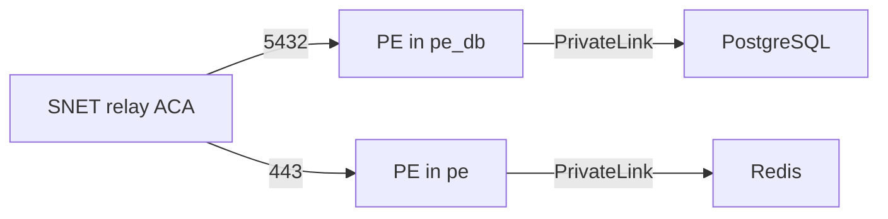
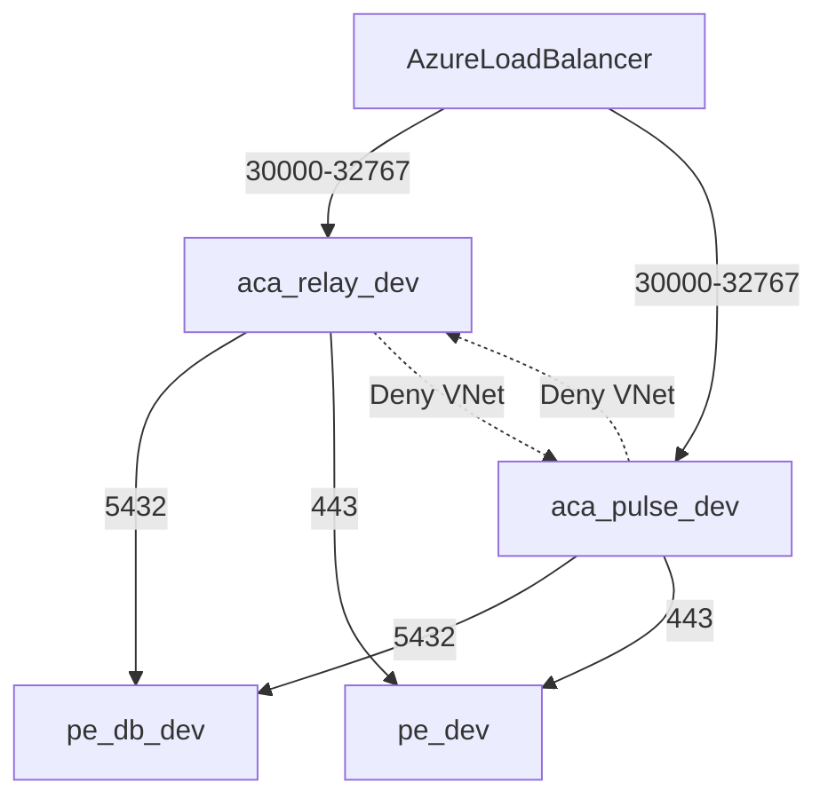
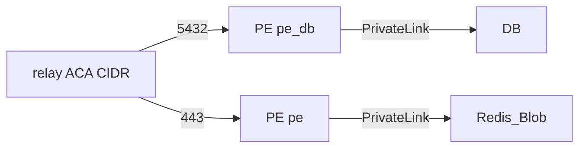

# 公网扫描打到数据库，才发现子网边界没划清

## 背景

relay dev 的 **PostgreSQL Flexible Server**（托管 PostgreSQL）一直开着 **Public network access**；监控里昨晚境外地址在扫 **5432**，连接串还是公网主机名。

---

pulse 的 **Azure Container Apps**（无服务器容器平台）没做 **Virtual Network**（虚拟网络）注入，流量还走默认公网 **FQDN**。harbor 的 prod 在 **EA**，小 D 翻过去一看，也是应用、库都露在公网上。

---

平台组的小 D 对了一轮清单：境外扫 **5432** 是一头；队与队之间眼下只有 **Resource Group** 分界，**VNet** 里子网没划全——谁挨谁、库和 **PE** 该落在哪块，表上还缺行。

---

bob 在群里问「先动应用还是先动库」，小 D 回了一句：「先把环境接到 **VNet**，子网边得先画出来。」**Front Door**、**WAF** 怎么接，另起一张表，这轮只管内网分段。

## 对比：全线公网

```hcl
resource "azurerm_postgresql_flexible_server" "relay_dev" {
  name                          = "relay-pg-dev-sea"
  resource_group_name           = "RG-RELAY-DEV-SEA"
  location                      = "southeastasia"
  public_network_access_enabled = true
}

resource "azurerm_container_app_environment" "relay_dev" {
  name                     = "relay-aca-env-dev-sea"
  resource_group_name      = "RG-RELAY-DEV-SEA"
  infrastructure_subnet_id = null
}
```

队与队 **ACA** 之间只有不同 **Resource Group**（资源组），没有子网边界；**Storage**、**Redis** 也走公网 **Endpoint**。

## 对比：收进内网（用户走 Front Door + WAF，子网对内）

「关公网、上 **PE**，不就完了？」小 D 补了一句：暴露面能关，**邻居**还得靠子网边——用户仍走 **Front Door** + **WAF**，下文只画数据面接入同一 **VNet** 时怎么分段。

**ACA** 挂上 **VNet** 后，同网段默认仍能互访，**Resource Group** 拦不住。运行环境要带 **Microsoft.App/environments** delegation，且**一环境一块子网**，于是每队各占一块 `aca_*`。

**PE** 落在子网里的 **NIC** 上：数据库走 **5432**、通用服务走 **443**，若挤在同一段不好区分——数据库 **PE** 进 `pe_db_*`，Redis、Blob、KV 进共享 `pe_*`。数据面路径：**ACA → PE → 后端**。

| 对外 | 对内（按角色分子网） |
|------|----------------------|
| **Front Door** + **WAF** → 内网 **ACA** | 数据面关公网，走 **Private Endpoint** |
| 不散落默认域名 | `aca_*` 每队 · `pe_db_*` 库 · `pe_*` 通用 **PE** |



```hcl
virtual_networks = {
  dev_sea_01 = {
    name             = "VNET-EG-DEV-SEA-01"
    location         = "southeastasia"
    address_space    = ["172.20.0.0/22"]
    subscription_key = "dev"
    subnets = {
      aca_relay_dev = {
        name             = "SNET-EG-DEV-ACA-RELAY"
        address_prefixes = ["172.20.0.0/26"]
        delegation = {
          name         = "Microsoft.App/environments"
          service_name = "Microsoft.App/environments"
          actions      = ["Microsoft.Network/virtualNetworks/subnets/join/action"]
        }
      }
      aca_pulse_dev = {
        name             = "SNET-EG-DEV-ACA-PULSE"
        address_prefixes = ["172.20.0.64/27"]
        delegation = {
          name         = "Microsoft.App/environments"
          service_name = "Microsoft.App/environments"
          actions      = ["Microsoft.Network/virtualNetworks/subnets/join/action"]
        }
      }
      pe_db_dev = {
        name             = "SNET-EG-DEV-PE-DB"
        address_prefixes = ["172.20.0.128/27"]
      }
      pe_dev = {
        name             = "SNET-EG-DEV-PE"
        address_prefixes = ["172.20.0.160/27"]
      }
    }
  }
}
```

```hcl
resource "azurerm_private_endpoint" "relay_pg" {
  name      = "pe-relay-pg-dev"
  subnet_id = data.azurerm_subnet.pe_db_dev.id
  # private_service_connection -> postgresqlServer
}

resource "azurerm_private_endpoint" "relay_redis" {
  name      = "pe-relay-redis-dev"
  subnet_id = data.azurerm_subnet.pe_dev.id
}
```

## 做法

**dev / prod** × **region**（SEA、EA）各一张 **VNet**，`subscription_key` 用 `dev`、`prod`，地址段互不重叠：

| VNet 键 | Region | 环境 | 地址空间 |
|---------|--------|------|----------|
| `dev_sea_01` | southeastasia | dev | `172.20.0.0/22` |
| `prod_sea_01` | southeastasia | prod | `172.21.0.0/22` |
| `prod_ea_01` | australiaeast | prod | `172.22.0.0/22` |

1. 在 `virtual_networks` 为每队加 `aca_*` 子网与 delegation；**PE** 登记在 `pe_db_*`、`pe_*`，队 **ACA** 环境接入对应 `aca_*`。
2. 关数据面公网；数据库 **PE** 只进 `pe_db_*`，Redis、Blob、KV 等进共享 `pe_*`。
3. 各子网挂 **NSG**，把允许的出入站写成规则；队 **ACA** 加 **Deny VirtualNetwork**；要更细再拆单独 PE 子网。
4. **EA**、**SEA** 复用同一键名模式，只换 `address_space` 与 `location`。

## NSG 基本规则（dev SEA 为例）

子网分好角色之后，**NSG** 绑在子网上，按源、目的、端口写 Allow 规则；没写进规则的流量不指望能通。

dev SEA 上常见三类：**ACA** 出向只开到 `pe_db`、`pe` 前缀；`pe_db` 入向只认各队 **ACA** CIDR；队与队 **ACA** 横向加 **Deny VirtualNetwork**（**Allow** 的 priority 数值要更小，先放行再拦宽）。

**ACA** 子网入站要给 **Azure Load Balancer** 留 **30000–32767**（健康探测与门户入站）。下面两幅图只画内网允许通行的路径：第一幅全队，第二幅收窄到 relay 一条 **ACA → PE → 后端**。





## 示例与验证

| 目录 | 用意 |
|------|------|
| [`security/shared-vnet-subnet-nsg-edges/`](https://github.com/NewbMiao/terraform-on-azure-examples/tree/main/security/shared-vnet-subnet-nsg-edges/) | 三环境 `virtual_networks` + **NSG** 规则示意；阅读顺序见该目录 `README.md` |

## 思考题

`pe_db_*` 只挂数据库的 **Private Endpoint**，`pe_*` 挂 Redis、Blob、KV 等——除了端口不同，把数据库和通用服务拆成两段子网，还有哪些好处？

## 小结

境外扫 **5432** 把账算清了：光靠关公网不够，同一 **VNet** 里还得把子网按角色画出来。用户仍走 **Front Door** + **WAF** 进 **ACA**，数据面 **ACA → PE → 数据库**；每队一块 **ACA** 子网，**NSG** 只放行写进规则的流量，**Resource Group** 隔不开邻居流量。